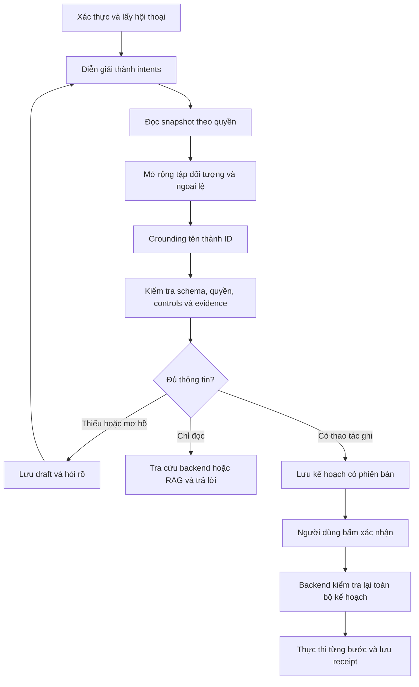

# Agent workflow

## Xung đột thiết bị

`device_conflicts` là nguồn quy tắc chính thức. Backend đọc lại quy tắc khi ghi trạng thái, đối chiếu cả thiết bị đang chạy và từng trạng thái trung gian của kế hoạch. Cặp khai báo một chiều vẫn được kiểm tra hai chiều; `same_room` chỉ áp dụng trong cùng phòng. Không tự suy luận thêm cặp cấm từ tên thiết bị. Thiết bị có `power` dùng trạng thái đó; quạt không có `power` dùng `speed > 0`. Thiếu trạng thái để kết luận thì không cho kích hoạt cặp liên quan.

- `ask`: chưa bật thiết bị mới; agent hỏi chọn hoặc đề xuất tắt thiết bị đang chạy trước. Đồng ý bật cả hai không vượt qua quy tắc.
- `reject`: chặn trạng thái chạy đồng thời.
- `auto_off_other`: kiểm tra thao tác tắt, tắt thiết bị xung đột trước rồi mới bật thiết bị được yêu cầu. Nếu tắt thất bại thì không bật tiếp. Các thao tác tắt được đưa vào phần xem trước và chính sách xác nhận; tắt thiết bị nhạy cảm vẫn cần xác nhận.

Snapshot trả `device_conflicts` đã lọc theo nhà. Sau kiểm tra tham số cục bộ, agent gọi `validate_plan` nội bộ qua backend: chỉ mô phỏng, không tạo pending action và không thực thi. Kết quả conflict có ID hai thiết bị, policy, trạng thái không rõ và lời giải thích để model chọn câu hỏi tiếp theo. Tool kiểm tra này không được đưa vào danh sách tool cho model tự gọi.

Backend kiểm tra lại toàn bộ kế hoạch trước khi chạy và chặn tại `DeviceStore.apply_action`, kể cả kế hoạch cũ đã được xác nhận, điều khiển trực tiếp và lịch tự động. Kịch bản chạy theo lịch được mô phỏng toàn bộ trước tác động đầu tiên; lịch gặp `ask`/`reject` ghi thất bại thay vì tự đồng ý. Không hỗ trợ chờ trả lời người dùng trong worker lịch.

Giới hạn triển khai: trạng thái thiết bị hiện là mô phỏng trong bộ nhớ, được lưu PostgreSQL. Khóa kiểm tra/ghi bảo vệ các yêu cầu đồng thời trong **một process backend**; không bảo đảm đồng bộ nhiều worker/replica hay trạng thái vật lý ngoài hệ thống. Khi chuyển sang thiết bị thật hoặc nhiều replica, cần nguồn trạng thái dùng chung và xác nhận tắt thực tế trước khi bật thiết bị khác. Không có migration hay biến môi trường mới cho thay đổi này.

## Chính sách xác nhận theo ảnh hưởng

Backend áp dụng `application/action_policy.py` sau khi đã chuẩn bị và kiểm tra toàn bộ kế hoạch. Đèn, quạt, điều hòa, rèm, TV và loa với các action cho phép được thực thi ngay. Khóa cửa, camera, ổ cắm, thiết bị nhiệt/nước nóng, action/loại thiết bị chưa được phân loại và mọi thay đổi kịch bản/lịch vẫn chờ xác nhận. Chạy kịch bản xét từng command đã mở rộng, không chỉ xét tên tool. Trên 3 thiết bị hoặc trên 5 commands cần xác nhận. Chỉ một bước nhạy cảm cũng giữ cả chuỗi chờ; không tự thực hiện phần còn lại.

`turns/commit` mặc định `confirmation_mode=policy`; tùy chọn `always` chỉ tăng mức bảo vệ cho client muốn xác nhận rõ ràng, không có tùy chọn ép bỏ xác nhận. Model không được quyết định chính sách. Không cần biến `.env` hoặc migration mới; kế hoạch chờ trước khi cập nhật vẫn chờ xác nhận.

Kế hoạch chạy ngay được ghi và chuyển `executing` trong cùng transaction với commit lượt hội thoại, rồi dùng executor/preflight/receipt hiện có. Retry chỉ đọc receipt, không nhận lại quyền thực thi. Nếu worker chết sau khi nhận quyền, trạng thái `executing` được giữ để người dùng kiểm tra/phục hồi thủ công; không tự chạy lại tác động chưa biết kết quả. Phản hồi trả `completed_actions` cùng kết quả thật; `pending_actions` chỉ chứa kế hoạch cần nút xác nhận. Chat và Aura hiển thị receipt không kèm nút xác nhận; lỗi giữa chuỗi báo rõ số bước hoàn tất và các bước bỏ qua.

Chế độ `/chat` của các script đánh giá interpreter cũ đã bị chặn trước khi gửi HTTP: chúng còn mong đợi nhãn phân tích cũ và việc không bấm xác nhận không còn đồng nghĩa chỉ đề xuất. `evaluate_agent.py --mode analyze` vẫn chỉ đọc. Bộ đánh giá native mới cần tài khoản/DB test riêng; không dùng corpus điều khiển lên nhà thật chỉ để kiểm tra ngôn ngữ.

## Giải phóng lease khi access token hết hạn

`turns/begin` trả `cleanup_token` riêng cho AI service, ký bởi backend và ràng buộc user/home/request/lease, thời hạn 10 phút. Token này chỉ dùng ở `POST /api/dashboard/agent/turns/{request_id}/release`, không được dùng như access token, refresh token, commit kế hoạch hoặc quyết định thực thi. Token không được đưa vào phản hồi chat, lịch sử hay state lưu DB. Không cần cấu hình thêm secret hoặc migration.

AI chạy cleanup trong `finally` nếu đã nhận lease nhưng chưa hoàn tất request, gồm cả lỗi 401, lỗi provider, timeout và hủy coroutine. Cleanup dùng credential riêng thay cho access token đã hết hạn, có timeout 10 giây; lỗi cleanup được log theo request ID và loại lỗi, không ghi token. Backend khóa session và kiểm tra đồng thời request/lease; credential cũ không thể mở khóa một lần retry mới. Khi backend không truy cập được, lease TTL 5 phút vẫn là cơ chế phục hồi dự phòng.

Frontend hiện giữ nguyên body và `request_id` khi refresh access token sau 401. AI chỉ trả lỗi 401 sau khi đã đợi cleanup, để frontend có thể gửi lại ngay. Bộ kiểm thử gồm token thực đã hết hạn ở giữa luồng HTTP AI/backend, retry cùng request ngay, chống replay cleanup, token sai phạm vi/hết hạn, hủy request và một kiểm thử trình duyệt bảo đảm request ID không đổi.

## Luồng chat hiện tại: tool loop

`/chat` và Aura dùng `ToolConversationAgent` trong `agent/tool_agent.py`. LangGraph chạy `load_dialogue → start_turn → reason → run_tools → reason … → finish → commit`; nhánh không có tool kết thúc lượt, nhánh cached không gọi model lại. Model nhận các tool thực thay cho `submit_interpretation`, nên không xuất `kind`, `relation`, `task_action`, `intents` hay bằng chứng trích dẫn. Mỗi kết quả tool được gửi lại bằng message role `tool` để model chọn bước tiếp theo, sửa tham số hoặc hỏi rõ.

Tool đọc gọi backend/RAG bằng token hiện tại. Model chỉ có `propose_plan` để đề xuất toàn bộ thao tác ghi, không có tool thực thi. Các bước được kiểm tra schema, quyền, phạm vi ID, controls, giới hạn giá trị và trạng thái trước; cả batch phải hợp lệ. Backend tiếp tục chuẩn bị và tái kiểm tra kế hoạch khi người dùng xác nhận. Đề xuất không được công bố là đã thực hiện; truy vấn chen ngang giữ nguyên kế hoạch, `cancel_pending_request` hủy kế hoạch. Giới hạn 10 lượt model/tool mỗi request, tối đa 48 bước kế hoạch; lỗi vượt giới hạn giải phóng lease.

Lịch sử user/assistant/tool được lưu trong state JSONB của phiên hiện có, cùng receipt thực thi. Transcript cắt ở ranh giới lượt user để không tạo message tool mồ côi. Không thêm bảng hay object riêng theo từng kiểu câu. Khi reload, model vẫn nhận hội thoại và kết quả tool; dữ liệu lịch sử không thay thế việc đọc trạng thái mới. Endpoint `/analyze` và `ConversationAgent` cũ còn phục vụ chế độ quan sát/kiểm thử tương thích, không phải entry point chat production.

Lượt kiểm tra model thật đã hoàn tất sáu lượt HTTP 200: hỏi nhiệt độ → “phòng khách” → “còn phòng ngủ?” → giảm 2°C → hỏi chen ngang → hủy. Backend tạo đúng đề xuất điều hòa phòng ngủ từ 24°C xuống 22°C; không xác nhận thực thi, hỏi chen ngang giữ nguyên plan, hủy loại bỏ plan. Quan sát còn hạn chế: model có lúc dùng kết quả lượt trước và nói sai rằng điều hòa tắt không có mức nhiệt; prompt đã làm rõ hai điểm này, chưa coi một hội thoại là bảo đảm hiểu mọi cách nói.

Các mục dưới ghi lịch sử triển khai và observer, đặc biệt những ràng buộc nhãn trung gian không còn áp dụng cho chat tool loop.

## Hội thoại theo ngữ cảnh (19/11/2026)

Luồng `/chat` dùng lịch sử user/assistant được server lưu, kết quả đọc và tác vụ đang chờ để LLM suy luận câu mới, kể cả câu rút gọn. Schema chat không yêu cầu `quote`, `source`, `evidence`, `memory_ref` hay `scope_evidence`; không thêm object nhớ mới cho từng cách nói. Lựa chọn đối tượng được đối chiếu dữ liệu nhà hiện tại, không dùng phép tìm chuỗi nguyên văn để công nhận ý định. Bộ lọc còn nhiều ứng viên vẫn hỏi chọn. Code tiếp tục kiểm tra schema tool, quyền, phạm vi dữ liệu, controls, giá trị và xác nhận kế hoạch ghi. Suy luận ngữ nghĩa vẫn phụ thuộc model, không phải bảo đảm mọi cách nói đều được hiểu đúng.

Các mô tả về bằng chứng trích dẫn bên dưới ghi lại cơ chế cũ; `/analyze` vẫn giữ chế độ kiểm tra trích dẫn cho quan sát. Payload/state cũ còn đọc được để tránh mất phiên và kế hoạch, nhưng chat không yêu cầu tạo lại các annotation đó. Memory và dữ liệu hội thoại vẫn lưu cùng cơ chế PostgreSQL hiện có, không cần migration.

Kiểm thử mới kiểm tra câu chọn phòng, chuyển tham chiếu theo lịch sử, thao tác tương đối không có quote vẫn chờ xác nhận, từ chối đối tượng không tồn tại và schema tương thích provider. Lượt thử model cuối đã liệt kê thiết bị và hỏi chọn đúng ba điều hòa; lượt “phòng khách” bị provider HTTP 402, nên chưa xác minh trọn chuỗi hội thoại thực trên phiên bản này.

Chat và Aura dùng chung workflow LangGraph, với hội thoại và kế hoạch lưu ở backend PostgreSQL. `/api/ai/analyze` là endpoint phân tích chỉ đọc; `/api/ai/chat` chạy workflow đầy đủ.

## Luồng xử lý



LLM chỉ diễn giải và soạn câu trả lời. Code chọn ID từ dữ liệu có quyền truy cập, kiểm tra tham số và quyết định có thể tạo kế hoạch hay cần hỏi rõ. Token xác thực không được gửi tới model hoặc lưu vào hội thoại.

## Thành phần

| File trong `homate_ai/agent/` | Vai trò |
| --- | --- |
| `capabilities.py`, `tools.py` | Catalog 18 tools, schema, quyền và tác động |
| `interpretation.py`, `interpreter.py`, `prompts.py` | Structured interpretation, evidence, targets, sửa output tối đa một lần |
| `analysis.py`, `grounding.py`, `validation.py` | Snapshot, đối chiếu đối tượng, tham số và provenance |
| `dialogue.py`, `policy.py` | Làm rõ, hủy, hướng dẫn xác nhận |
| `memory.py` | Context cho interpreter, chuyển trạng thái yêu cầu và memory có bằng chứng |
| `planner.py` | Tập thiết bị, ngoại lệ, thứ tự và phụ thuộc |
| `graph.py`, `runtime.py`, `state.py` | LangGraph hội thoại và điều phối |

Backend có `application/agent_workflow.py`, repository PostgreSQL và HTTP router tương ứng. Migration `0005_agent_workflow.py` thêm `agent_sessions`, `agent_turns`, `agent_plans`, `agent_plan_steps`; giữ bảng `agent_actions` cũ.

## Loại yêu cầu

- Lệnh đơn đủ tham số: tạo kế hoạch chờ xác nhận.
- Thiếu phòng/đối tượng hoặc có nhiều kết quả: hỏi lại, lưu draft; câu trả lời ngắn như “phòng khách” tiếp tục yêu cầu trước.
- Thiếu giá trị: hỏi số cụ thể; không tự gán nhiệt độ cho “mát hơn chút”. “Giảm 2 độ” được tính từ trạng thái backend và kiểm tra lại khi chạy.
- Chuỗi lệnh: giữ thứ tự và phụ thuộc, tối đa 48 bước; hỗ trợ đọc dữ liệu backend sau thao tác ghi.
- “Tất cả … trừ …”: mở rộng từ snapshot; ngoại lệ không khớp phải làm rõ.
- Sửa hoặc hủy yêu cầu: vô hiệu hóa kế hoạch cũ, tăng phiên bản khi cần. Câu hỏi chỉ đọc giữ kế hoạch đang chờ.
- Yêu cầu có phần chưa hỗ trợ: không âm thầm bỏ phần đó. Đề nghị chỉ làm phần độc lập đã hỗ trợ, sau đó vẫn phải xác nhận kế hoạch.
- Tra cứu điện năng, kịch bản, lịch và tài liệu: backend/RAG theo quyền.

Câu tự nhiên vẫn phụ thuộc interpreter. Evidence tồn tại không chứng minh model hiểu hoàn toàn đúng ý nghĩa; người dùng cần đọc bản kế hoạch trước khi xác nhận.

## Hội thoại, xác nhận và lỗi

Phản hồi chat/Aura mặc định 1–2 câu ngắn, tập trung vào kết quả hoặc bước tiếp theo. Mỗi lượt chỉ hỏi một thông tin thiếu, ưu tiên đối tượng trước giá trị; không liệt kê lỗi schema hay đưa nguyên văn lỗi backend. Chi tiết thao tác nằm trong thẻ xác nhận. Người dùng yêu cầu hướng dẫn/giải thích chi tiết thì vẫn có thể trả lời dài hơn. Prompt soạn câu trả lời và tóm tắt kết quả dùng chung quy tắc này; không cắt chuỗi máy móc làm mất số liệu, nguồn hoặc thông tin lỗi. Đây là hướng dẫn phong cách cho model, không phải bảo đảm cứng về số câu.

Frontend chỉ lưu ID hội thoại trong localStorage theo tài khoản và kênh `chat`/`voice`. Backend giữ tối đa 60 tin nhắn và draft, thời hạn hội thoại 30 phút không hoạt động. Đây là memory hội thoại, chưa có memory sở thích lâu dài. Client history không phải nguồn có thẩm quyền trong `/chat`.

### Hiểu quan hệ giữa các lượt

Interpreter trả `dialogue` cùng với intents, không có bộ bắt mẫu câu riêng cho điều hòa hay câu hỏi nhiệt độ:

- `relation`: `new_request`, `follow_up`, `clarification_answer`, `correction`, `resume`, `topic_change`, `cancel`, `unclear`.
- `task_action`: `preserve` (giữ việc đang chờ), `replace` (yêu cầu đầy đủ mới/sửa), `clear` (bỏ việc đang chờ).
- `topic`, `user_goal`: diễn giải của model về chủ đề và mục tiêu, không phải dữ kiện thiết bị đã được xác nhận.

Model nhận lịch sử user/assistant gần đây, `active_task`, `side_question`, trạng thái kế hoạch và `conversation`. State này lưu trong JSONB của `agent_sessions`; không cần migration mới. `conversation` gồm chủ đề, mục tiêu, entities đã grounding, lượt vừa xử lý, observations từ kết quả đọc và execution receipt do backend cập nhật. Không để model tự ghi dữ kiện thiết bị hoặc trạng thái thực thi vào memory.

Một câu hỏi đọc, kể cả chưa rõ đối tượng, có thể giữ nguyên draft và kế hoạch thao tác trước đó. Câu hỏi chưa rõ được lưu riêng trong `side_question`. Khi quay lại bổ sung/sửa, model diễn giải toàn bộ yêu cầu từ `active_task`, không lấy câu hỏi chen ngang làm yêu cầu cần sửa. `follow_up`/`unclear` không được xóa việc cũ; `preserve` không được đồng thời đề xuất ghi. Output mâu thuẫn yêu cầu model sửa tối đa một lần, sau đó báo không diễn giải được.

Với snapshot, model dùng `read_focus` để mô tả đối tượng cần hỏi và `requested_fields` để chọn thông số. Đây không phải tham số API backend. Code grounding đối tượng theo snapshot có quyền truy cập và bằng chứng từ lời user trước/mới, rồi đọc dữ liệu mới và giới hạn kết quả gửi tới bước soạn trả lời. Nếu không xác định duy nhất hoặc chỉ có lời assistant làm bằng chứng thì hỏi rõ. Model không được lấy thông số mục tiêu trong kế hoạch để nói thành trạng thái hiện tại.

Model có thể chọn `memory_ref` trong Target/read_focus để trỏ tới `reference_id` đã cung cấp trong context. Danh sách này có nhãn `active_task` và `recent_topic`, không tự chọn đối tượng cuối. Code xác minh lại ID trong snapshot mới, bằng chứng user gốc còn trong lịch sử và các bộ lọc không mâu thuẫn. Tham chiếu lạ, ngoài phạm vi hoặc mâu thuẫn bị chặn. Đây là liên kết do model chọn theo hội thoại, không phải bộ nhận diện mẫu câu.

Interpreter kiểm tra trích dẫn theo đúng nguồn user trước khi grounding và cho model một lượt sửa lỗi định dạng/bằng chứng (ví dụ trích dẫn ghép từ hai đoạn không liên tục). Nếu sau đó bằng chứng vẫn sai thì validation tiếp tục chặn; không tự tạo bằng chứng hoặc bỏ kiểm tra để thực thi.

Backend giữ conversation memory khi hoàn tất/từ chối/đóng kế hoạch gián đoạn, bỏ active task và gắn trạng thái/kết quả từng bước thực tế vào `execution`. Mở hội thoại mới hoặc hết hạn vẫn không dùng lại state cũ. Memory phản ánh ý định và dữ kiện riêng biệt; khả năng suy luận đúng quan hệ vẫn phụ thuộc model và cần đo bằng hội thoại nhiều lượt.

Mỗi lượt có `request_id`, phiên bản hội thoại và lease 5 phút với nonce riêng. Request lặp lại trả kết quả đã lưu; request đồng thời hoặc phiên bản cũ bị chặn. Worker cũ không được commit hoặc giải phóng lease mới.

Kế hoạch có `plan_version` riêng, nội dung bất biến và thời hạn xác nhận. Nút Xác nhận gửi ID + phiên bản trực tiếp tới backend. Nói “đồng ý” không thực thi thao tác. Backend kiểm tra quyền, trạng thái và dữ liệu trước khi chạy; đánh dấu mỗi bước `running` trước side effect.

Một bước lỗi thì giữ các bước thành công và bỏ qua phần còn lại. Không rollback toàn bộ hoặc tự chạy lại thao tác có kết quả chưa xác định. Nếu process dừng giữa side effect và ghi receipt, không thể bảo đảm exactly-once với thiết bị bên ngoài.

Kế hoạch `executing` không có heartbeat hơn 5 phút được đánh dấu cần kiểm tra. Người dùng tải lại hội thoại, kiểm tra thiết bị, tích xác nhận đã kiểm tra rồi chọn **Đóng kế hoạch gián đoạn**. Backend giữ kết quả đã biết, đánh dấu bước đang chạy có kết quả chưa xác định và bỏ qua bước còn lại. Worker đến muộn không được ghi đè receipt hoặc chạy bước tiếp; side effect đã bắt đầu vẫn có thể hoàn tất muộn. Không tự retry.

## API

| Endpoint | Mục đích |
| --- | --- |
| `POST /api/ai/chat` | Text + request_id + conversation_id/conversation_version |
| `POST /api/ai/analyze` | Báo cáo chỉ đọc, `mode=observe`, `executable=false` |
| `GET /api/ai/capabilities` | Catalog đã xác thực |
| `GET /api/dashboard/agent/conversations/{id}` | Khôi phục tin nhắn và kế hoạch |
| `DELETE /api/dashboard/agent/conversations/{id}` | Đóng hội thoại, hủy kế hoạch đang chờ |
| `POST /api/dashboard/agent/plans/{id}/decision` | `{approved, version}` |
| `POST /api/dashboard/agent/plans/{id}/recover` | `{version, acknowledged:true}`, chỉ khi gián đoạn |
| `POST /api/ai/plans/{id}/summary` | Diễn đạt receipt theo quyền, không gọi tool |

Các endpoint `/turns/begin`, `/turns/{id}/commit`, `/turns/{id}/abort` phục vụ AI–backend; backend luôn kiểm tra ownership và lease.

## Kiểm thử và evaluation

Tests dùng model giả lập kiểm tra hỏi rõ, provenance, đổi phiên bản, idempotency, lease, partial failure, phục hồi và quyền. Backend tests tạo database PostgreSQL riêng. Playwright kiểm tra chat và Aura.

Corpus `apps/ai-service/evals/natural_language.json` có 28 câu tiếng Việt. Đặt token đăng nhập của tài khoản test vào `HOMATE_ACCESS_TOKEN`, rồi chạy từ thư mục project:

```powershell
.\.venv\Scripts\python.exe tools/evaluate_agent.py --mode analyze --output .work/agent-eval-analyze.json
.\.venv\Scripts\python.exe tools/evaluate_agent.py --mode chat --output .work/agent-eval-chat.json
```

Script gọi LLM có thể tính phí. Chế độ chat tạo hội thoại riêng, không xác nhận kế hoạch, đóng hội thoại sau mỗi case. Không commit token hoặc báo cáo chứa dữ liệu nhà. Kết quả phụ thuộc model và dữ liệu seed; tỷ lệ unit tests không phải độ chính xác ngôn ngữ.

Corpus hội thoại nhiều lượt nằm ở `apps/ai-service/evals/conversations.json` (hỏi chen ngang, bổ sung sau gián đoạn, quay lại sửa, chuyển chủ đề và làm rõ tự nhiên). Chạy với `HOMATE_ACCESS_TOKEN` như trên:

```powershell
.\.venv\Scripts\python.exe tools/evaluate_conversations.py --output .work/conversation-eval.json
```

Script chỉ đề xuất, không xác nhận thao tác, đóng hội thoại sau khi kiểm tra. Báo cáo lưu theo từng hội thoại, kiểm tra quan hệ, bảo toàn draft/kế hoạch, đúng đối tượng tra cứu và dữ liệu backend; không chỉ chấm câu trả lời nghe có vẻ đúng.

Bản memory ngày 18/11/2026: 90 tests AI local và 49 tests backend với PostgreSQL đều qua. Các lượt kiểm tra model thật được giữ trong `.work/memory-conversation-*.json`; có lượt hỏi tiếp đã giải đúng đối tượng, nhưng chưa có hội thoại hoàn chỉnh đạt. Lượt 5 hội thoại gần nhất ghi nhận 0/5 hoàn tất vì các lỗi HTTP provider; kiểm tra chẩn đoán xác định HTTP 402, thông báo liên quan tín dụng/token. Vì vậy chưa thể xác nhận chất lượng end-to-end của bản này; không lấy kết quả unit tests thay cho độ chính xác ngôn ngữ. Khi provider có thể phục vụ lại, chạy lại corpus nhiều lượt trên cùng phiên bản.

Lượt kiểm tra ngày 17/11/2026: 62 tests AI, 48 tests backend với PostgreSQL và 11 tests trình duyệt đều qua. Frontend build và ESLint các file thay đổi đều qua. Full frontend lint còn lỗi có sẵn ngoài phạm vi workflow.

Đánh giá `/chat` qua OpenRouter đang cấu hình, cùng ngày: **17/28 đạt (60,7%)** trong một lượt, không xác nhận thực thi kế hoạch. Có 8 ca không đạt tiêu chí diễn giải và 3 ca HTTP 503. Đây là điểm end-to-end trên corpus hiện tại, không phải ước lượng độ chính xác cho mọi câu tiếng Việt.

Các lỗi quan sát được: model đặt `targets`/`conditions` bên trong `arguments` thay vì trường cùng cấp, chọn control tức thời cho yêu cầu lịch, không điền tên đối tượng kịch bản vào target, và tạo intent capability null cho câu chào khiến validator phân loại unsupported. Validator chặn các tham số sai cấu trúc, nhưng trải nghiệm hỏi rõ vì vậy chưa tốt. Ba ca 503 ở lượt đầu chưa đủ dữ liệu để quy nguyên nhân cụ thể.

Bản sửa sau đánh giá chuẩn hóa vị trí metadata intent (`targets`, `conditions`, `evidence`, phụ thuộc...) khi model đặt bên trong `arguments`: giữ nguyên nội dung, đưa về trường cùng cấp rồi kiểm tra Pydantic, grounding và validation như bình thường. Nếu hai vị trí có nội dung không rỗng mâu thuẫn thì không ghi đè; yêu cầu model sửa tối đa một lần. Tham số ngoài schema của tool cũng yêu cầu sửa, không tự bỏ giá trị hoặc tự đổi capability. Các trường scope/credential lạ vẫn chuyển tới validator để từ chối rõ ràng. Intent trò chuyện chỉ được rút gọn về danh sách rỗng nếu hoàn toàn không có capability, tham số, mục tiêu, điều kiện hay thông tin chưa rõ; không bỏ qua ý thao tác. Prompt bổ sung quy tắc lịch, tên cũ/mới của kịch bản và tham chiếu lịch sử. Sau các sửa đổi này, 70 kiểm thử AI local đã qua.

Lỗi 503 có header `X-Agent-Error`: `interpreter_schema_invalid`, `provider_http_error`, `provider_response_invalid` hoặc `agent_unavailable`. Bộ đánh giá ghi mã HTTP và mã lỗi thuộc danh sách cho phép, không ghi credential hoặc body lỗi provider.

Hai lượt đánh giá sau sửa được giữ riêng: bản yêu cầu model sửa output đạt 14/28 (`.work/agent-eval-chat-fixed.json`); bản chuẩn hóa vị trí metadata đạt 17/28 (`.work/agent-eval-chat-normalized.json`). Lượt sau có 3 lỗi schema interpreter, 1 lỗi HTTP provider và 7 ca không đạt tiêu chí. Chuỗi lệnh, yêu cầu hỗn hợp, câu chào và lịch thiếu giờ đã đạt ở lượt sau; tổng điểm chưa tăng so với baseline. Kết quả cho thấy cần tiếp tục cải thiện interpreter, không thể coi các lỗi ngôn ngữ đã được xử lý hết.

Sau lượt này bổ sung chặn phủ định thao tác bằng code trước khi lập kế hoạch: các mẫu như “đừng bật”, “không được mở”, “khỏi tắt” buộc hỏi rõ nếu model đề xuất ghi, kể cả khi model biến thành hành động ngược lại. Đây là kiểm tra bảo thủ cho các mẫu đã nhận diện, chưa phải bộ phân tích phủ định tiếng Việt hoàn chỉnh. Bản cuối có **74 tests AI local đạt**; đánh giá riêng case `negation` qua OpenRouter đạt **1/1**, báo cáo `.work/agent-eval-negation-guard.json`. Không cộng kết quả một case chạy riêng vào điểm corpus đầy đủ; chưa chạy lại toàn bộ corpus sau bổ sung guard.

Báo cáo chi tiết lưu local tại `.work/agent-eval-chat.json` (Git ignore). Cần cải thiện hợp đồng structured output và xử lý intent hội thoại, thêm regression tests từ các ca này rồi đánh giá lại; không bỏ validation để tăng tỷ lệ đạt.

## Kiểm tra kế hoạch đọc

Diễn giải khai báo `answer_sources`: `backend` cho dữ liệu nhà hiện tại, `knowledge` cho tài liệu, `conversation` cho tác vụ/lịch sử và `general` cho trò chuyện. Schema gửi model yêu cầu trường này; các payload cũ vẫn được đọc với giá trị mặc định rỗng. Mọi `query`/`mixed` phải có intent, và nguồn backend/knowledge được khai báo phải có capability đọc tương ứng. Kế hoạch thiếu được yêu cầu sửa một lần; nếu vẫn sai, luồng dừng trước khi tạo câu trả lời. Đây là kiểm tra tính nhất quán của kế hoạch, chưa bảo đảm model luôn chọn đúng nguồn hoặc tool về mặt ngữ nghĩa.

Câu hỏi mới/đổi chủ đề phải giữ tác vụ đang chờ; `clear` chỉ dành cho hủy rõ ràng. Khi tool đọc lỗi, hệ thống báo chưa tra cứu được, không để model diễn giải lỗi thành danh sách rỗng. Kết quả đọc thành công nhưng rỗng được giữ nguyên để trả lời từ dữ liệu thật; dữ liệu backend không cần citation tài liệu RAG.

Kiểm thử bổ sung tại `tests/test_read_contract.py`: sửa kế hoạch rỗng, chặn kế hoạch tiếp tục thiếu, kiểm tra nguồn đọc, bảo toàn tác vụ, đọc lỗi, đọc thành công rỗng và câu hỏi về hội thoại. Tổng cộng 98 tests AI qua. Kiểm tra OpenRouter sau sửa đã có lượt liệt kê đúng 22 thiết bị với trace `get_home_snapshot` thành công; model còn gọi thêm `get_energy_report` không cần thiết. Hai lượt tiếp theo lỗi HTTP provider nên chưa xác minh hết hội thoại thực.

## Giới hạn

Đối tượng đọc được giải quyết tại `agent/read_scope.py`: mô tả một đối tượng dùng grounding để tìm ứng viên; nhiều ứng viên tạo câu hỏi chọn, không tự chọn thiết bị đầu tiên. Nhiều mô tả được người dùng chỉ định và phạm vi `scope=all` được hỗ trợ cho snapshot; kết quả lọc hợp nhất các thiết bị/phòng/kịch bản đã xác minh. Quote không có trong lời USER không được dùng làm bằng chứng, kể cả tên từng xuất hiện trong lời assistant. Khi làm rõ xong một yêu cầu đọc, draft tra cứu được kết thúc; tác vụ ghi đang chờ vẫn được giữ. Bộ kiểm thử AI sau bổ sung có 105 tests qua. Phạm vi đọc tất cả yêu cầu scope_evidence riêng từ lời USER. Lượt OpenRouter cuối đã trả danh sách ứng viên cho câu hỏi điều hòa mơ hồ; lượt chọn phòng tiếp theo bị provider HTTP 402, nên chưa xác minh đủ bốn lượt trên cùng bản cuối. Lượt thử trước đã đọc đúng điều hòa phòng ngủ (24°C) và tất cả ba điều hòa (24/26/25°C).

Chưa có trigger cảm biến tùy ý kiểu “nếu nóng hơn 30 độ thì …”, dependency RAG sau thao tác ghi, phụ thuộc tiến/lặp chu kỳ, alias học từ người dùng, memory sở thích dài hạn, tự retry hoặc rollback side effect. Đối chiếu tên chuẩn hóa dấu/hoa thường rồi khớp chính xác; không tự đoán thiết bị gần giống.
