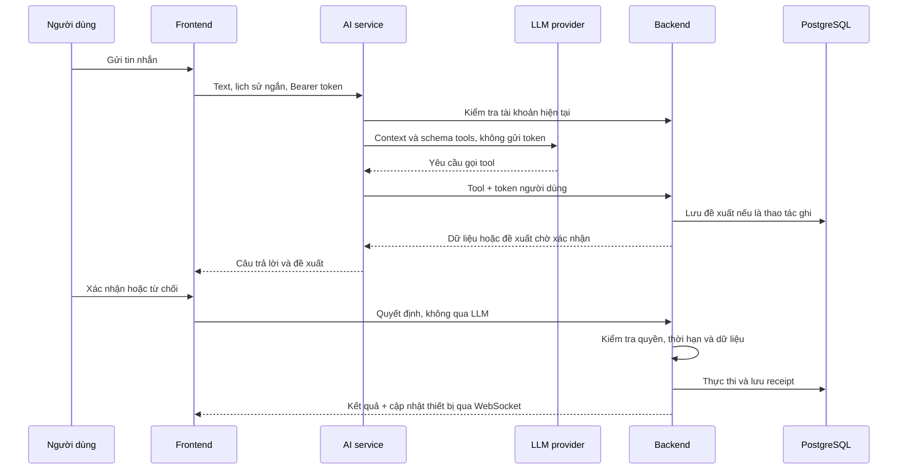

# Kiến trúc trợ lý HomeMate

AI service cung cấp trợ lý, 17 tools và cơ chế đề xuất thao tác. Backend quản lý dữ liệu, phân quyền, validation và thực thi. STT/TTS local hoạt động qua `SpeechService` và HTTP adapters tới `speech-service` (Sherpa-ONNX + Piper). RAG, audio streaming và ngắt lời tự động chưa triển khai. Xem [luồng giọng nói](voice.md).

## Thành phần và chiều phụ thuộc



```text
apps/ai-service/src/homate_ai/
  domain/conversation.py        # ModelReply, ToolCall và lỗi nghiệp vụ
  application/
    orchestrator.py             # Vòng điều phối agent
    tools.py                    # Hợp đồng tools
    ports.py                    # Model, backend, STT/TTS và retrieval interfaces
  infrastructure/
    llm.py                      # Chat Completions adapter
    backend_client.py           # Backend HTTP adapter
  presentation/http.py          # Request validation và HTTP routes
  config.py                     # Cấu hình provider
  bootstrap.py                  # Composition root và vòng đời HTTP clients
```

Domain/application không import FastAPI, HTTP client hoặc provider SDK. Infrastructure hiện thực các port. AI service không kết nối PostgreSQL và không có quyền quản trị riêng; mọi tool mang token của người yêu cầu.

## Tools hiện có

| Nhóm | Tool | Hành vi |
|---|---|---|
| Nhà | get_home_snapshot | Phòng, thiết bị, controls, trạng thái và kịch bản |
| Điện năng | get_energy_report | Lọc period, room_id, device_id, anchor |
| Thiết bị | control_device | Đề xuất điều khiển thiết bị |
| Kịch bản | list_scenes, get_scene | Danh sách và chi tiết |
| Kịch bản | create_scene, update_scene, delete_scene | Đề xuất tạo/sửa/xóa |
| Kịch bản | set_scene_enabled, execute_scene | Đề xuất bật/tắt hoặc chạy |
| Lịch | list_schedules, get_schedule | Danh sách và chi tiết |
| Lịch | create_schedule, update_schedule, delete_schedule | Đề xuất tạo/sửa/xóa |
| Lịch | set_schedule_enabled | Đề xuất bật/tắt |
| Lịch | get_schedule_runs | Lịch sử thực thi |

`get_energy_report` nhận period: today, 7days, 30days, 3months, week, month hoặc year. `anchor` dùng YYYY-MM-DD; bỏ trống để dùng ngày hiện tại. Nếu đồng thời lọc phòng và thiết bị, thiết bị phải thuộc phòng đó. Dữ liệu điện năng hiện là ước tính.

`list_schedules` lọc room_id, scene_id và include_finished. Update nhận `changes` chứa trường muốn thay đổi; steps của kịch bản thay toàn bộ danh sách bước, không tự nối vào danh sách hiện có.

Tools đọc dùng được cho thành viên. Quản lý kịch bản/lịch cần admin. Agent lấy ID từ tools đọc, không được tự đoán ID. API backend vẫn kiểm tra phạm vi nhà và dữ liệu nhận được.

## Điều phối và các loại câu lệnh

Agent có tối đa 6 vòng gọi model. Một vòng có thể nhận câu trả lời hoặc tool calls; kết quả đọc được gửi lại model để trả lời hoặc gọi tool tiếp. Khi có đề xuất pending, agent trả về giao diện và chờ người dùng quyết định.

| Loại yêu cầu | Mức hỗ trợ |
|---|---|
| Lệnh đơn, tra cứu, quản lý kịch bản/lịch | Có tools tương ứng; cách diễn đạt được LLM diễn giải |
| Tra cứu nhiều bước | Có thể gọi tools trong nhiều vòng |
| Lệnh có thời gian | Tool tạo/sửa lịch; backend kiểm tra thời gian và quy tắc lặp |
| Nhạy cảm | Mọi thao tác ghi hiện đều yêu cầu xác nhận |
| Mơ hồ hoặc thiếu thông tin | Prompt yêu cầu hỏi lại; chưa có bộ phát hiện/clarification state riêng |
| Câu nối tiếp | Dựa vào context hội thoại ngắn; chưa có resolver tham chiếu riêng |
| Chuỗi thao tác tự do có thứ tự | Chưa có planner bảo đảm thứ tự và độ phủ toàn bộ chuỗi |
| Phủ định, ngoại lệ, điều kiện | Chưa có xử lý chuyên biệt hoặc automation theo điều kiện |
| Hủy bằng lời | Chưa có tool hủy; dùng nút Từ chối |

Kịch bản đã cấu hình chạy các bước theo thứ tự. Việc hiểu ngôn ngữ và các trường hợp phức tạp cần kiểm thử với LLM thật; validation, phân quyền và xác nhận được thực thi bằng code backend.

## Memory

Frontend giữ tin nhắn trong React state và gửi tối đa 12 tin nhắn user/assistant gần nhất. Backend không lưu hội thoại; reload hoặc rời màn hình chat sẽ mất lịch sử. Lịch sử do client gửi là context, không phải bằng chứng quyền truy cập hay thực thi.

Các đề xuất/receipt và nhật ký được lưu PostgreSQL nhưng chưa được dùng làm memory hội thoại. Chưa có long-term memory, hồ sơ sở thích, RAG hoặc phục hồi hội thoại qua phiên đăng nhập.

## Xác nhận và chống chạy lặp

Backend lưu `agent_actions`, gắn user, home, request UUID, arguments, nội dung review và expires_at. Thời hạn theo cài đặt HITL. Các trạng thái:

```text
pending → rejected
pending → expired
pending → executing → executed / failed
```

Unique(user_id, request_id) tránh tạo lặp. Gửi lại cùng request ID với nội dung khác bị từ chối. Row lock chuyển pending sang executing trước khi thực thi; người dùng khác không thể quyết định. Gửi quyết định lặp trả receipt hiện có mà không chạy lại.

Lúc xác nhận, backend đọc lại quyền và kiểm tra dữ liệu. Kịch bản/lịch thay đổi kể từ lúc đề xuất làm thao tác sửa/xóa thất bại và cần đề xuất mới. Ràng buộc khóa ngoại vẫn áp dụng khi xóa kịch bản được lịch tham chiếu.

Receipt và mọi side effect không nằm trong một transaction nguyên tử. Process chết sau khi claim có thể để lại executing. Kịch bản nhiều thiết bị có thể chạy một phần nếu persistence lỗi giữa chừng. Kiểm tra trạng thái thực tế trước khi tạo yêu cầu mới; không tự retry các receipt đó. Backend hiện dành cho một process.

## Cấu hình và API

Hướng dẫn đầy đủ tại [Cài đặt và vận hành](getting-started.md). OpenRouter dùng LLM_PROVIDER=openrouter, OPENROUTER_API_KEY và OPENROUTER_MODEL_NAME. OpenAI dùng các biến tương ứng. Adapter hiện dùng Chat Completions và cần model hỗ trợ function calling; đổi giao thức provider cần adapter riêng.

| Endpoint | Chức năng |
|---|---|
| GET /api/ai/status | Trạng thái cấu hình text/voice/RAG |
| POST /api/ai/chat | Tin nhắn, request_id và history; yêu cầu Bearer token |
| GET /api/dashboard/agent/identity | Tài khoản và vai trò hiện tại |
| POST /api/dashboard/agent/tools | Tool request có xác thực |
| POST /api/dashboard/agent/actions/{id}/decision | Xác nhận/từ chối trực tiếp backend |

Thiếu key, AI service vẫn khởi động và chat trả 503. Key chỉ ở server; không nằm trong prompt hoặc frontend. Health/configured không kiểm tra hạn mức hay tính hợp lệ của key.

## Kiểm thử và hướng phát triển

AI tests dùng model và HTTP transport giả lập: auth trước khi gọi model, giới hạn vòng lặp, tool allowlist, proposal và hợp đồng adapter. Test cũng đối chiếu tên tools AI với backend. Backend integration tests dùng PostgreSQL thật cho phân quyền, dữ liệu, confirmation, expiry, retry, quản lý kịch bản/lịch và điện năng. Browser tests giả lập chat, gọi backend thật để kiểm tra điều khiển.

Các bước tiếp theo:

1. Bộ đánh giá câu tiếng Việt với provider thật: lệnh đơn, mơ hồ, chuỗi, phủ định và lỗi provider.
2. Planner có kế hoạch cấu trúc và luồng hỏi lại có trạng thái.
3. Hội thoại bền vững, phục hồi phiên và xử lý receipt executing.
4. Audio streaming và ngắt lời; STT/TTS hiện dùng Aura trên header, thu âm theo lượt và tự phát phản hồi.
5. RAG ingestion/retrieval có nguồn và lọc theo home. Trạng thái thiết bị luôn lấy từ backend tools.
