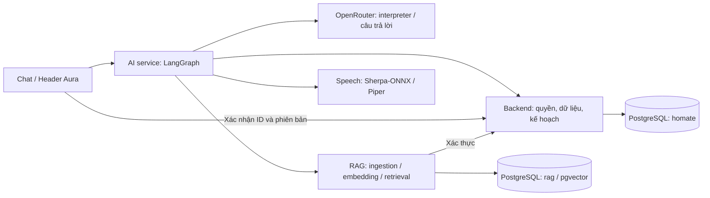

# Kiến trúc AI HomeMate

Chat/Aura hiện dùng vòng lặp tool native tại `agent/tool_agent.py`: LLM nhận hội thoại → chọn tool → nhận kết quả tool → chọn bước tiếp theo hoặc trả lời/hỏi rõ. Không bắt model quản lý các nhãn `relation`/`task_action`. Tool đọc chạy trực tiếp; `propose_plan` kiểm tra cả batch và chuyển backend tạo kế hoạch chờ xác nhận. Model không có tool thực thi ghi. Hội thoại/tool messages được lưu theo phiên PostgreSQL hiện có. Xem mục “Luồng chat hiện tại” trong [agent workflow](agent-workflow.md) cho graph, giới hạn và kiểm chứng; các mô tả interpreter dưới đây còn áp dụng cho observer `/analyze`.

AI service dùng LangGraph để diễn giải câu tự nhiên, làm rõ thông tin thiếu và tạo kế hoạch có kiểm tra. Backend giữ dữ liệu nghiệp vụ, quyền truy cập, hội thoại và quyền thực thi. Xem [agent workflow](agent-workflow.md) cho hợp đồng và xử lý lỗi.



Các service trao đổi qua HTTP. STT và TTS chạy chung `speech-service`, tách process khỏi AI/backend. RAG chạy riêng, dùng schema vector riêng trong cùng PostgreSQL. Frontend gọi API qua nginx/Vite proxy.

## Cấu trúc AI service

```text
homate_ai/
  agent/
    graph.py, state.py, runtime.py  # LangGraph hội thoại
    capabilities.py, tools.py      # Catalog và schema 18 tools
    interpretation.py              # Intent, Target, Evidence, báo cáo
    interpreter.py, prompts.py     # Structured output và few-shot
    analysis.py                    # Pipeline phân tích, snapshot
    grounding.py, validation.py    # ID, tham số, quyền, provenance
    dialogue.py, policy.py         # Làm rõ, hủy, phản hồi
    planner.py                     # Tập đối tượng, thứ tự, phụ thuộc
    models.py                      # Model reply/tool call/error
  clients/
    llm.py, backend.py, workflow.py, rag.py
  speech/
    service.py, client.py
  api/routes.py
  contracts.py, config.py, bootstrap.py
```

Graph chat: `load_dialogue → interpret → gather_data → plan_scope → ground → validate → decide → remember → commit`. Interpreter trả cả quan hệ hội thoại lẫn ý định lượt hiện tại trong một structured output. Node `remember` giữ yêu cầu đang chờ riêng với câu hỏi chen ngang và cập nhật memory từ kết quả đã kiểm tra. Retry đã hoàn tất kết thúc ngay ở bước load. State LangGraph sống trong request; backend quản lý state hội thoại bền vững, không lưu credential vào checkpointer.

## Tools và thực thi

Catalog gồm tra cứu snapshot/điện năng/kịch bản/lịch/lịch sử chạy, điều khiển thiết bị, quản lý kịch bản và lịch, chạy kịch bản và `search_knowledge`. Schema tools là hợp đồng; capability registry bổ sung quyền, tác động và dữ liệu cần đọc.

Interpreter không tự gọi API ghi. Kết quả phải qua grounding/validation. Backend chuẩn bị kế hoạch, người dùng xác nhận đúng phiên bản, backend kiểm tra lại và thực thi lần lượt. Receipt lưu kết quả từng bước. Lỗi giữa chuỗi dừng phần còn lại; retry request/decision không chạy lại các bước đã nhận xử lý.

`/analyze` dùng pipeline chỉ đọc, không tạo kế hoạch. `/chat` có memory hội thoại PostgreSQL, clarification, correction và cancellation. Memory này chưa lưu sở thích dài hạn.

## Speech và RAG

Aura thu âm, gửi STT, chuyển text qua cùng workflow chat rồi phát phản hồi bằng TTS. Text và kế hoạch hiển thị trong header. Chat/voice có ID hội thoại riêng theo tài khoản. Nói “đồng ý” vẫn yêu cầu bấm xác nhận kế hoạch.

RAG trả nội dung và nguồn tài liệu để AI gắn citations. RAG không thay thế dữ liệu trạng thái thiết bị hoặc quyền thực thi của backend. Chưa hỗ trợ bước RAG phụ thuộc sau thao tác ghi trong cùng kế hoạch.

Xem [voice](voice.md), [RAG](rag.md), [cài đặt](getting-started.md), [workflow và evaluation](agent-workflow.md).
