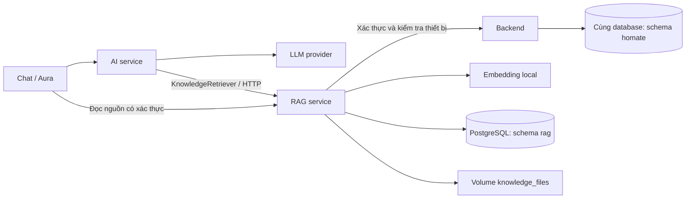

# RAG service

`rag-service` sở hữu toàn bộ ingestion, chia đoạn, embedding local, lưu/tìm vector, metadata và file tài liệu. Không còn `embedding-service` riêng hoặc trang Knowledge trên giao diện. Chat và Aura vẫn hiển thị nguồn đã truy xuất.

## Cấu trúc theo luồng RAG

```text
src/homate_rag/
├── ingestion/
│   ├── loader.py          # Nhận nội dung Markdown/TXT
│   ├── chunking.py        # Chia đoạn có overlap
│   ├── pipeline.py        # Load → chunk → embed → index
│   └── documents.py       # Quản lý nguồn và liên kết thiết bị
├── embedding/
│   ├── model.py           # Model, kích thước và kiểm tra vector
│   └── encoder.py         # FastEmbed local, cache model
├── indexing/
│   ├── pgvector.py        # Lưu tài liệu/chunks và truy vấn vector
│   ├── connection.py      # Kết nối schema rag
│   └── migrate.py         # Tạo schema, role và tiếp nhận dữ liệu cũ
├── retrieval/
│   ├── pipeline.py        # Query → embed → search → context
│   └── context.py         # Đoạn trích, metadata và đường dẫn nguồn
├── storage/files.py       # File tài liệu gốc
├── clients/backend.py     # Xác thực và kiểm tra thiết bị qua backend
├── api/                   # HTTP routes và xác thực request
├── app.py                 # Khởi tạo API và tài nguyên dùng chung
├── cli.py                 # Nạp/quản lý tài liệu từ terminal
└── config.py
```

Code được tổ chức theo các bước RAG, không dùng các lớp Clean Architecture. Generation nằm ở AI service: RAG trả nguồn, còn agent tạo câu trả lời và đánh số trích dẫn. Chưa có reranker hoặc query rewriting.



## Chạy Docker

```powershell
docker compose up --build -d
```

Các service chính: backend port 8000, AI port 8010, speech port 9020 và RAG port 9030. Model multilingual MiniLM 384 chiều được tải lúc build RAG image và chạy local bằng FastEmbed/ONNX; LLM vẫn dùng provider đã cấu hình.

`rag-migrate` là job chạy một lần, dùng tài khoản quản trị DB để tạo schema/quyền trước khi RAG khởi động. Nó đợi backend healthy để các migration nghiệp vụ hoàn tất. Runtime RAG dùng role `homate_rag`, không dùng tài khoản quản trị. Job thoát thành công sau khi thiết lập xong là trạng thái bình thường.

Nếu còn container `homate-embedding-service-1` của bản cũ, dừng và xóa container đó để nhường port 9030. Không xóa volume dữ liệu.

## Chung database, riêng quyền sở hữu

Vẫn dùng database PostgreSQL hiện tại, không tạo vector database riêng:

```text
homate (database)
├── homate (schema): devices, scenes, schedules, users, ...
└── rag (schema): documents, document_devices, chunks
```

Role runtime `homate_rag` không có quyền superuser, tạo database hoặc tạo role; chỉ sở hữu schema/bảng RAG, không đọc được bảng trong `homate`. `home_id`, `created_by`, `device_id` được giữ dưới dạng metadata, không có FK xuyên sang bảng nghiệp vụ. RAG gọi backend bằng bearer token của người yêu cầu để kiểm tra tài khoản, vai trò và phạm vi thiết bị.

`RAG_DB_PASSWORD` cấu hình mật khẩu role trong Compose; mặc định chỉ dành cho local. Khi chạy local ngoài Docker, dùng `RAG_DATABASE_URL` tương ứng và URL-encode mật khẩu nếu có ký tự đặc biệt. Thay mật khẩu cần chạy lại job migrate và tạo lại container RAG để đồng bộ cấu hình.

File Markdown/TXT lưu với tên UUID trong volume `knowledge_files`. Tên file do người dùng cung cấp chỉ là metadata. DB lưu nguyên văn các đoạn, vector và vị trí; một tài liệu có thể liên kết nhiều thiết bị mà không embed lại.

## Chuyển dữ liệu từ bản RAG cũ

Sao lưu PostgreSQL và volume tài liệu trước khi chuyển. Job migrate có thể chạy lặp lại; nó chuyển các bảng cũ và giữ nguyên ID, embedding, liên kết và metadata:

| Trước | Sau |
|---|---|
| `homate.knowledge_documents` | `rag.documents` |
| `homate.device_documents` | `rag.document_devices` |
| `homate.knowledge_chunks` | `rag.chunks` |

Volume file được gắn từ backend sang RAG, không cần copy hay embed lại. Nếu đồng thời có bảng cũ và bảng mới, migration dừng để tránh ghi đè dữ liệu.

Migration backend `0004_knowledge.py` được giữ như lịch sử vì đã được áp dụng ở bản trước. Backend không còn API hay code runtime xử lý kiến thức. Với database mới, job RAG tiếp nhận các bảng tương thích này sau khi backend migration hoàn tất. Không downgrade migration lịch sử để di chuyển dữ liệu ngược; cần migration riêng nếu muốn quay lại kiến trúc cũ.

## Quản lý tài liệu bằng CLI

Chưa có trang quản lý tài liệu. CLI gọi API RAG, không truy cập DB trực tiếp. Mặc định CLI hỏi PIN qua prompt ẩn rồi đăng nhập backend; có thể dùng access token hiện có qua biến môi trường `HOMATE_ACCESS_TOKEN`.

Ví dụ nạp hướng dẫn HomeMate mẫu:

```powershell
docker compose cp docs/knowledge/homate-guide.md rag-service:/tmp/homate-guide.md
docker compose exec rag-service python -m homate_rag.cli ingest /tmp/homate-guide.md --title "Hướng dẫn HomeMate"
```

CLI mặc định dùng tài khoản `minh-duc`. Để dùng tài khoản khác, thêm `--user USER_ID` trước subcommand.

```powershell
# Danh sách tài liệu trong nhà
docker compose exec rag-service python -m homate_rag.cli list

# Nạp manual, liên kết một hoặc nhiều thiết bị
docker compose exec rag-service python -m homate_rag.cli ingest /tmp/manual.md --title "Hướng dẫn thiết bị" --device light-living

# Thay toàn bộ liên kết thiết bị; bỏ --device để thành tài liệu chung
docker compose exec rag-service python -m homate_rag.cli link DOCUMENT_ID --device light-living

# Tìm đoạn tài liệu, không gọi LLM
docker compose exec rag-service python -m homate_rag.cli search "Lịch tự động hỗ trợ kiểu lặp nào?"

# Xóa tài liệu và các đoạn/liên kết của nó
docker compose exec rag-service python -m homate_rag.cli delete DOCUMENT_ID
```

Admin mới được ingest/link/delete. Thành viên cùng nhà được list/search/đọc nguồn. File phải là Markdown/TXT UTF-8, tối đa 100 KB qua CLI; API giới hạn nội dung 100.000 ký tự. Chưa có PDF/OCR, sửa nội dung tại chỗ hoặc ingestion nền. Để thay nội dung, nạp bản mới rồi xóa bản cũ.

### Bộ hướng dẫn thiết bị mô phỏng

Thư mục [knowledge/devices](knowledge/devices/) chứa hướng dẫn riêng cho từng thiết bị trong dữ liệu mô phỏng. [manifest.json](knowledge/devices/manifest.json) ghi tên file và thiết bị được liên kết. Nội dung dựa trên tên, phòng, controls, giới hạn và quy tắc điều khiển của HomeMate; không có hãng/model, mã lỗi, lịch bảo trì hay hướng dẫn sửa phần cứng do tự suy đoán. Không đưa trạng thái hiện tại vào tài liệu.

Để sinh và nạp bộ này từ danh sách thiết bị đang có, chạy từ thư mục repo, nhập PIN admin khi được hỏi:

```powershell
.\.venv\Scripts\python.exe tools/seed_device_knowledge.py
```

Script gọi API qua `http://127.0.0.1:5173`, ghi Markdown vào `docs/knowledge/devices`, rồi nạp qua RAG API và liên kết đúng `device_id`. Tài liệu giống hệt sẽ được dùng lại. Nếu cấu hình thiết bị thay đổi, xem lại Markdown đã sinh rồi dùng `--replace-generated` để nạp bản mới và thay các bản tự sinh trước đó; không xóa manual khác hoặc hướng dẫn HomeMate chung. Có thể truyền `--url` nếu frontend chạy ở địa chỉ khác hoặc dùng `HOMATE_ACCESS_TOKEN` thay prompt PIN.

Ví dụ câu hỏi: “Theo tài liệu, điều hòa phòng khách hỗ trợ chế độ nào?”, “Đèn phòng ngủ có chỉnh độ sáng không?”, “Quạt thông gió phòng tắm có các mức nào?”. Các câu hỏi về trạng thái hiện tại vẫn lấy qua backend tools. Những tài liệu này phục vụ thử nghiệm RAG trên mô phỏng, không thay thế manual thiết bị thật.

## API và kết nối

RAG cung cấp API port 9030, được Nginx/Vite proxy theo `/api/rag/`:

| Method / URL | Chức năng |
|---|---|
| `GET /api/rag/documents` | Danh sách theo nhà |
| `POST /api/rag/documents` | Admin nạp `title`, `filename`, `content`, `device_ids` |
| `PUT /api/rag/documents/{id}/devices` | Admin thay liên kết |
| `DELETE /api/rag/documents/{id}` | Admin xóa |
| `GET /api/rag/documents/{id}/source` | Văn bản gốc có xác thực |
| `GET /api/rag/search?query=...&device_id=...` | Tìm nguồn trong phạm vi nhà |

AI service giữ interface `KnowledgeRetriever` và adapter `HttpKnowledgeRetriever`, gọi thẳng RAG cho tool `search_knowledge`; tool này không nằm trong danh sách tools nghiệp vụ backend. Home ID và vai trò được RAG lấy từ backend, không nhận từ LLM. Backend chỉ cung cấp identity và snapshot đã lọc theo nhà, không biết cách tạo embedding hay tìm vector.

Khi lọc `device_id`, chỉ tài liệu liên kết thiết bị đó được tìm. Tài liệu chung vẫn được dùng khi không có device filter. Trạng thái thiết bị, lịch hiện tại và điện năng tiếp tục lấy qua backend tools.

## Chất lượng và giới hạn

Tìm kiếm cosine chính xác, tối đa 5 đoạn với điểm tối thiểu 0.35. Chưa có ANN index, reranker hoặc đánh giá retrieval tự động. Ngưỡng cần hiệu chỉnh theo bộ tài liệu thực tế.

Nguồn hiển thị lấy từ kết quả RAG, không lấy URL do model tự tạo. Prompt yêu cầu trích dẫn `[1]`, `[2]` và báo thiếu thông tin khi không có nguồn, nhưng LLM vẫn có thể trả lời sai; cần kiểm tra đoạn trích. Tài liệu là dữ liệu không đáng tin cậy, không phải system instructions. Mọi thao tác ghi vẫn do backend kiểm soát và yêu cầu xác nhận.

Xóa DB và file không phải transaction phân tán; lỗi ổ đĩa có thể để lại file mồ côi, nhưng file không còn truy cập được qua API sau khi bản ghi bị xóa.

## Phát triển local

```powershell
.\.venv\Scripts\python.exe -m pip install -e "apps/rag-service[test]"
.\.venv\Scripts\python.exe -m uvicorn homate_rag.app:create_app --factory --host 127.0.0.1 --port 9030
```

Chuẩn bị schema/role bằng job `rag-migrate` Docker trước; cấu hình `RAG_DATABASE_URL`, `BACKEND_URL`, `KNOWLEDGE_DIRECTORY`, `MODEL_CACHE`. AI local dùng `RAG_URL=http://127.0.0.1:9030`. Để dùng tài liệu trong Docker volume, chạy RAG trong Docker thay vì trỏ sang thư mục local trống.
