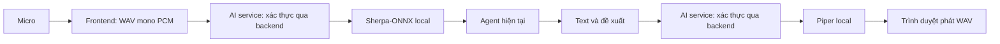

# Giọng nói local

STT dùng Sherpa-ONNX Zipformer tiếng Việt 30M int8; TTS dùng Piper với giọng `vi_VN-vais1000-medium`. Không cần key STT/TTS. LLM vẫn dùng OpenAI/OpenRouter như cấu hình hiện tại.

## Chạy Docker

Từ thư mục project, với Docker Desktop Linux containers đang chạy:

```powershell
docker compose up --build -d
```

Lần build đầu tải model từ Hugging Face, cần Internet và có thể mất vài phút. Model nằm trong image; không cần tải lại khi restart container. Không cần sửa `.env` hiện tại để chạy Docker.

Mở `http://localhost:5173`, đăng nhập rồi dùng Aura trên header của ứng dụng:

1. Bấm quả cầu **Aura** trên header và cho phép truy cập micro.
2. Nói, sau đó bấm Aura lần nữa để gửi. Bản ghi tự dừng và gửi sau 60 giây.
3. STT chuyển audio thành text, agent xử lý và TTS tự phát phản hồi. Có thể bấm **Dừng đọc**.
4. Câu lệnh và phản hồi hiển thị ngay cạnh Aura trong header; nội dung dài có thể cuộn.
5. Với thao tác thay đổi dữ liệu, bấm xác nhận hoặc từ chối trên thẻ đề xuất trong header. Kết quả được đọc bằng TTS.

Voice tự gửi bản nhận dạng vào agent nhưng không tự chấp nhận thao tác. Audio không được lưu vào database. Lịch sử voice giữ riêng trong bộ nhớ header, tối đa 12 tin gửi vào agent; trang Assistant giữ chat văn bản riêng. Chưa có wake word hoặc streaming. Trình duyệt cần HTTPS hoặc localhost; truy cập bằng IP LAN qua HTTP thường không được phép dùng micro. Nếu trình duyệt chặn tự phát audio, phản hồi vẫn hiển thị trong header.

## Luồng và phân lớp



`application/speech.py` điều phối xác thực và gọi các port. `infrastructure/speech.py` hiện thực hai port bằng HTTP. `presentation/http.py` nhận audio/text và trả transcript/WAV. `bootstrap.py` kết nối các thành phần. Service engine độc lập nằm ở `apps/speech-service/`.

API công khai, yêu cầu Bearer token:

| Endpoint | Request | Response |
|---|---|---|
| `POST /api/ai/speech/transcribe` | Raw `audio/wav`, tối đa 6 MB | `{ "text": "..." }` |
| `POST /api/ai/speech/synthesize` | JSON `{ "text": "..." }`, tối đa 4.000 ký tự | `audio/wav` |

`GET /api/ai/status` báo cấu hình voice, không phải kiểm tra model đã load thành công. Engine load model khi xử lý lần đầu nên lượt đầu có thể chậm hơn. Chẩn đoán bằng `docker compose logs --tail=100 speech-service ai-service`.

## Chạy local

Từ thư mục project, cài vào môi trường ảo hiện có:

```powershell
.\.venv\Scripts\python.exe -m pip install -r apps/speech-service/requirements.txt
.\.venv\Scripts\python.exe apps/speech-service/download_models.py
.\.venv\Scripts\python.exe -m uvicorn app:app --app-dir apps/speech-service --host 127.0.0.1 --port 9020
```

Chạy backend, AI service và frontend ở các terminal khác theo [getting-started](getting-started.md). AI service mặc định kết nối `http://127.0.0.1:9020`; có thể đổi bằng `STT_URL` và `TTS_URL`. Địa chỉ engine trong Docker là `http://speech-service:9020`. Model local được Git ignore.

Model STT: [Sherpa-ONNX tiếng Việt](https://k2-fsa.github.io/sherpa/onnx/pretrained_models/offline-transducer/zipformer-transducer-models.html). Model TTS: [Piper vais1000](https://huggingface.co/rhasspy/piper-voices/tree/v1.0.0/vi/vi_VN/vais1000/medium).
